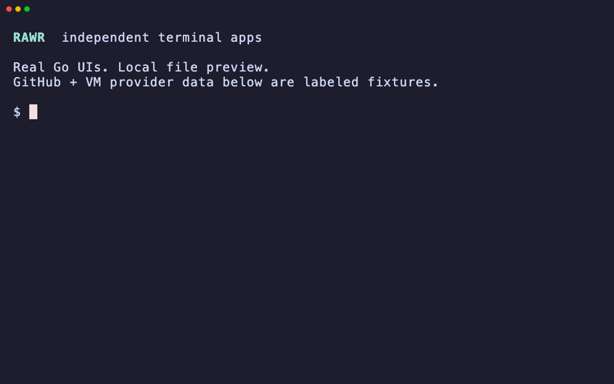

<p align="center">
  
</p>

# Rawr

Small apps that open native resource panes in [Rex](https://www.superlogical.com/rex). Browse beside your terminal; use resource actions to drive the main work pane.

Run one from a Rex terminal in your project:

```sh
ghrawr    # GitHub PRs, issues and checks
filerawr  # Files and Git changes
exerawr   # exe.dev VMs and SSH
```

The optional `rawr` command manages projects and saved setups.



*Native Rex demo with fixture data.*

## Install

[Download v0.2.1 for macOS/Linux](https://github.com/metcalfc/rawr/releases/tag/v0.2.1), or install with Go 1.24+:

```sh
go install github.com/metcalfc/rawr/cmd/ghrawr@v0.2.1
go install github.com/metcalfc/rawr/cmd/filerawr@v0.2.1
go install github.com/metcalfc/rawr/cmd/exerawr@v0.2.1
go install github.com/metcalfc/rawr/cmd/rawr@v0.2.1 # optional
```

See the [setup and usage guide](docs/USAGE.md) for Rex compatibility and dependencies.

## Write your own

Use [rawrkit](docs/RAWRKIT.md) for shared pane behavior and terminal UI. Start with the [noterawr example](examples/noterawr/main.go) and replace its resources and actions.

```sh
go get github.com/metcalfc/rawr@v0.2.1
```
