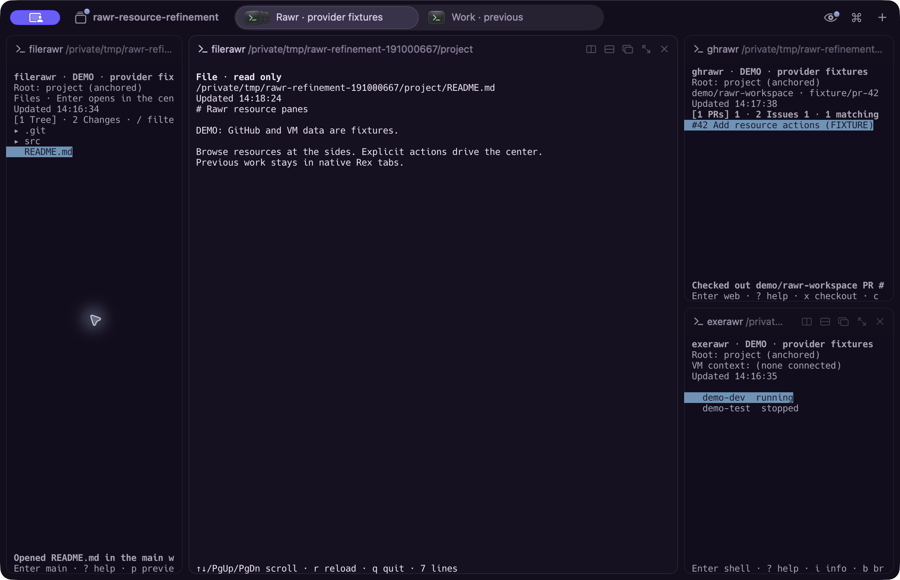

<p align="center">
  
</p>

# Rawr

Small resource panes. Your work in the center.

Rawr is a family of Go apps for [Rex](https://www.superlogical.com/rex). Browse files, pull requests, issues and VMs in independent native panes, then choose an explicit action for the selected resource. Open a file or diff in the central work pane, check out a PR into an idle local checkout, or connect a VM shell. Previous central work stays available in native tabs.



Actual Rex panes from the v0.2.0 walkthrough. The center displays a real file in a disposable project; GitHub and VM data are labelled fixtures. Previous local work is retained in the visible native tab.

**v0.2.0** adds repository-wide PR/issue browsing, file Changes and filters, central file/diff views, guarded PR checkout and quieter shell commands. Upgrading scripts from v0.1.0: add `--verbose` to keep receiving pane-action JSON. `--status` still prints JSON.

| Resource pane | Workflow |
| --- | --- |
| `filerawr` | Switch between Tree and Changes, filter filenames, and open a read-only file or diff in the center. |
| `ghrawr` | Browse open PRs/issues across the repository, inspect checks, open the browser, or confirm a guarded local PR checkout. |
| `exerawr` | Browse VM details, then explicitly connect the selected host's SSH shell in the center. |
| `rawr` *(optional)* | Name projects and deliberately save or restore their setups. |

## Work from the resource pane

1. In `ghrawr`, use `1` for PRs or `2` for issues and `/` to filter. Press `c` for PR checks or Enter/`o` for the browser. For a PR checkout, press `x`, review the prompt and confirm with `y`; the local repository must match and be clean, and Rex requires the original idle local shell in the center.
2. In `filerawr`, use `1` for Tree or `2` for Changes. Enter opens the selected file or diff read-only in the center, retaining prior work in a native history tab. Use `p` for a preview inside the file pane.
3. In `exerawr`, browse with arrows or a mouse selection, inspect with `i`, and press Enter/`s` to connect. `b` opens the selected VM in the browser. Existing local work and VM shells keep running.

Arrows and mouse selection browse; they do not launch work. `?` shows context help and `r` refreshes with loading/cached/error status. Running a command opens or focuses its existing pane; `--toggle` hides/shows it while retaining the process. Tools stay anchored to the project when focus moves to another terminal or SSH shell.

Successful pane actions are silent. Add `--verbose` (or `-v`) for their JSON details; `--status` always prints JSON and errors go to stderr. Rawr's optional project commands keep their structured output.

## Install v0.2.0

Download [v0.2.0 macOS and Linux binaries](https://github.com/metcalfc/rawr/releases/tag/v0.2.0) for arm64 or amd64. Go is not needed to run them. Follow the [download and checksum instructions](docs/USAGE.md#download-prebuilt-binaries).

Or install with Go 1.24 or later:

```sh
go install github.com/metcalfc/rawr/cmd/filerawr@v0.2.0
go install github.com/metcalfc/rawr/cmd/ghrawr@v0.2.0
go install github.com/metcalfc/rawr/cmd/exerawr@v0.2.0
# Optional projects and deliberately saved setups:
go install github.com/metcalfc/rawr/cmd/rawr@v0.2.0
```

## Run the apps

From a terminal inside Rex, in your project:

```sh
filerawr --root "$PWD"
ghrawr --root "$PWD" --repo OWNER/NAME
exerawr --root "$PWD"
```

Use `exerawr --local` from the same local context to return retained local work to the center. The apps also offer `--tui` in an ordinary interactive terminal; file Enter falls back to a local preview when there is no Rex center. See [the usage guide](docs/USAGE.md) for exact keys, checkout guards, roots and saved setups.

Already-running app processes keep their original UI code. Building or installing does not hot-upgrade them; use a fresh Rex session or explicitly reopen the tool panes you intend to update.

To build from a source checkout instead:

```sh
make build
export PATH="$PWD/build/bin:$PATH"
```

Release archives contain ready-to-run apps and public guides. Build commands use the [source checkout](https://github.com/metcalfc/rawr/tree/v0.2.0), which also contains the Makefile and verification scripts.

## Build another resource pane

The public [rawrkit SDK](docs/RAWRKIT.md) supplies native pane lifecycle, anchored context, managed central terminals and optional terminal UI helpers. Resource data and actions belong to the app; Rawr remains the optional project layer. Start with the [noterawr example](examples/noterawr/main.go).

## Scope and verification

The native integration baseline is **macOS**, **Rex Beta 0.1.0 (1758)**, CLI/server **`0.0.1793645657-gd018d2`**, API **10**. Other Rex versions and remote endpoints are rejected until verified. Turn **Autobalance splits off** for deliberate fixed pane sizes. The [public verification summary](docs/VERIFICATION.md) separates the v0.2.0 walkthrough from earlier evidence.

The v0.2.0 native resource walkthrough uses labelled GitHub/VM fixtures; earlier baseline acceptance separately exercised real SSH reuse. Linux native Rex behavior remains unverified; cross-compilation establishes build compatibility. GitHub uses existing `git`/`gh` authentication, and exe.dev uses existing SSH access. Terminal References, content text search, editor integration, pin/preview policies and additional activity features are not implemented. Rex continues to own native terminal hosting and activity; Rawr does not inject relaunch text or host arbitrary herdr plugins.

PR checkout also refuses a macOS login/wrapped shell when Rex cannot verify its idle shell foreground. A visible prompt is not treated as proof that checkout is safe.

## Earlier terminal recording


This historical v0.1.0 VHS GIF shows standalone `--tui` apps with sample GitHub/VM data. It does not show native Rex panes, central work switching or the v0.2.0 actions. [Recording scope and reproduction](https://github.com/metcalfc/rawr/tree/v0.2.0/demos).

## Inspiration

[herdr-radar](https://github.com/hhdebb/herdr-radar), [herdr-sidebar](https://github.com/alexarthurs/herdr-sidebar), [termscope](https://github.com/iurysza/termscope) and [clauth](https://github.com/uwuclxdy/clauth) are useful design references for resource navigation, contextual details, visible status and deliberate actions. Rawr applies those lessons through independent Rex panes and its own SDK; this is design inspiration, not plugin compatibility or credential/account management.

Rawr is an independent project, not affiliated with or endorsed by Rex or Superlogical. Rex and other product names and marks belong to their respective owners.
